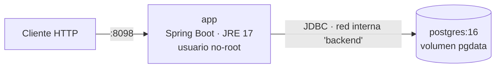
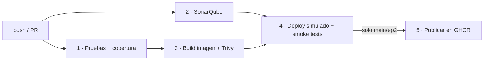

# Order Manager — Pipeline CI/CD (DOY0101 · Evaluación Parcial 2)

API REST de pedidos de e-commerce (Spring Boot 3.5, Java 17, PostgreSQL) con un pipeline
CI/CD completo en GitHub Actions: pruebas automatizadas, análisis de calidad y seguridad,
contenedores, despliegue automático en un entorno simulado y orquestación con Docker Compose.

**Integrantes:** Bastian Garrido - Jose Concha - Martin Gauna · **Docente:** Cristián R. Araya Salazar

---

## 1. Arquitectura



| Servicio   | Imagen                         | Puerto expuesto | Notas |
|------------|--------------------------------|-----------------|-------|
| `app`      | construida desde el `Dockerfile` | 8098            | filesystem de solo lectura, `cap_drop: ALL` |
| `postgres` | `postgres:16-alpine`           | ninguno         | solo accesible desde la red interna |

## 2. Cómo ejecutarlo

Requisitos: Docker Desktop (no hace falta Java ni Maven).

```bash
cp .env.example .env          # opcional: ajustar credenciales
docker compose up --build -d --wait
curl http://localhost:8098/actuator/health     # {"status":"UP"}
docker compose down -v                         # detener y borrar datos
```

Sin Docker (H2 en memoria): `mvn spring-boot:run` → `http://localhost:8098`.

### Endpoints principales

| Método | Ruta | Descripción |
|--------|------|-------------|
| GET | `/api/orders` | Lista pedidos |
| GET | `/api/orders/{id}` | Detalle |
| GET | `/api/orders/status/{status}` | Filtra por estado |
| POST | `/api/orders` | Crea pedido |
| POST | `/api/orders/{id}/items` | Agrega ítem (solo `PENDING`) |
| PUT | `/api/orders/{id}/confirm` · `ship` · `deliver` · `cancel` | Transiciones de estado |
| DELETE | `/api/orders/{id}` | Elimina |
| GET | `/actuator/health` · `/actuator/info` | Salud y versión desplegada |

## 3. Contenedores (Dockerfile multi-stage)

| Etapa | Base | Qué hace |
|-------|------|----------|
| `dependencies` | `maven:3.9-eclipse-temurin-17` | Descarga dependencias (capa cacheable mientras no cambie el `pom.xml`) |
| `test` | (hereda) | Corre `mvn test`; si falla, no hay imagen |
| `compile` | (hereda) | Genera el `.jar` |
| `prod` | `eclipse-temurin:17-jre-noble` | Solo JRE + `.jar`, usuario `app` sin privilegios, `HEALTHCHECK`, labels OCI con commit y versión |

## 4. Pipeline CI/CD (`.github/workflows/ci-cd.yml`)



| # | Job | Qué hace | Bloquea si… |
|---|-----|----------|-------------|
| 1 | `test` | `mvn verify`: 31 pruebas (JUnit 5 + Mockito + MockMvc) y reporte JaCoCo | falla una prueba o la cobertura de líneas < 70 % |
| 2 | `sonar` | Análisis estático con SonarQube Community (contenedor de servicio del job) y `qualitygate.wait=true` | el Quality Gate no se cumple |
| 3 | `build-scan` | Construye la imagen y la escanea con Trivy (HIGH/CRITICAL con parche) | hay vulnerabilidades no aceptadas |
| 4 | `deploy` | Levanta el stack con Docker Compose (`--no-build`, misma imagen escaneada) y corre pruebas de humo | no queda `healthy` o fallan las pruebas de humo |
| 5 | `publish` | Sube la imagen a `ghcr.io` con tag del commit y `latest` | (solo `main`/`ep2`) |

- **Dependabot** (`.github/dependabot.yml`): revisa semanalmente Maven, imágenes Docker, `docker-compose` y las Actions; abre un PR por cada actualización, que pasa por este mismo pipeline.
- **Entornos simulados:** `develop` → `staging`, `main` y `ep2` → `production` (Environments de GitHub; el despliegue corre con Docker Compose sobre el runner y se destruye al terminar).
- Las alertas se ven como *annotations* y en el *Job Summary* de cada ejecución; los bloqueos se aplican con ramas protegidas (sección 7).

## 5. Calidad

- Pruebas unitarias del servicio y del dominio, y pruebas web del controlador (`src/test`).
- Cobertura medida con JaCoCo y exigida en el build (`pom.xml`, regla `check`): mínimo 70 % de líneas.
- Quality Gate de SonarQube sobre el mismo reporte de cobertura (bugs, vulnerabilidades, code smells, duplicación).
- Las pruebas corren dos veces a propósito: en el job `test` (feedback rápido) y dentro de la etapa `test` del Dockerfile (garantiza que ninguna imagen se construye con pruebas rotas).

## 6. Trazabilidad (de commit a producción)

1. Cada ejecución del pipeline queda asociada a un commit (`github.sha`) y a su rama.
2. El commit se inyecta como `ARG GIT_COMMIT` en el Dockerfile → label OCI `org.opencontainers.image.revision` y variable de entorno de la app.
3. La app lo publica en `GET /actuator/info` (`app.commit`), junto con la versión y fecha de build.
4. El job `deploy` verifica en las pruebas de humo que el commit que informa la app **es igual** a `github.sha`.
5. La imagen que se escanea es la misma que se despliega y se publica (se pasa como artefacto entre jobs, no se reconstruye).
6. En GHCR cada imagen queda etiquetada con los 7 primeros caracteres del commit.
7. El *Job Summary* del despliegue registra commit, rama, número de run e ID de la imagen.

## 7. Seguridad y escalabilidad (parámetros ajustados)

| Área | Parámetro | Dónde |
|------|-----------|-------|
| Recursos | `limits` / `reservations` de CPU y memoria por servicio (app: 1 CPU / 768 MB, reserva 0,5 / 384 MB) | `docker-compose.yml` |
| JVM | `-XX:MaxRAMPercentage=75` (la JVM respeta el límite del contenedor) | `Dockerfile` / compose |
| Arranque ordenado | `healthcheck` en PostgreSQL + `depends_on: service_healthy` | `docker-compose.yml` |
| Resiliencia | `restart: unless-stopped`, `HEALTHCHECK` de la imagen | compose / Dockerfile |
| Privilegios | usuario no-root, `read_only`, `cap_drop: ALL`, `no-new-privileges` | compose / Dockerfile |
| Red | la base de datos no publica puertos | compose |
| Secretos | credenciales por variables de entorno (`.env` ignorado por git); contraseña efímera en el despliegue de CI | compose / workflow |
| Pipeline | permisos mínimos por job (`contents: read`, `packages: write` solo al publicar), Action de Trivy fijada por SHA | workflow |
| Aplicación | sin consola H2 ni detalle de `/health` en el perfil `docker` | `application-docker.properties` |
| Dependencias | Tomcat, pgjdbc y Jackson subidos de versión por CVE; 2 CVE de Spring sin parche en 6.x aceptadas y documentadas | `pom.xml`, `.trivyignore` |

## 8. Configuración en GitHub (una sola vez)

El pipeline no necesita secretos ni cuentas externas: SonarQube se levanta dentro del propio job y la publicación en GHCR usa el `GITHUB_TOKEN` automático.

1. **Ramas protegidas** (*Settings → Branches*): en `ep2` (y `main`/`develop` si se usan) exigir PR y los checks `Pruebas y cobertura`, `Análisis SonarQube` e `Imagen Docker y Trivy`. Esto convierte las puertas de calidad en un bloqueo real de merge.
2. **Dependabot:** *Settings → Code security* → habilitar *Dependabot alerts* y *security updates*.
3. **Paquetes:** el primer push a `main` crea el paquete en GHCR (*Packages*); si se quiere público, cambiar su visibilidad.

## 9. Declaración de uso de Inteligencia Artificial


- **Herramienta:** Claude Code (Anthropic, modelo Claude Sonnet 5.5).
- **Uso:** borrador de `Dockerfile`, `docker-compose.yml`, workflow de GitHub Actions, `dependabot.yml`, pruebas unitarias del dominio (`OrderTest`), análisis de vulnerabilidades con Trivy y redacción de las secciones descriptivas de este README. Los comandos se probaron localmente con Docker Desktop.
- **Validación:** el equipo debe revisar y comprender cada archivo antes de la entrega.
- **No se usó IA** para las justificaciones técnicas (sección 10) ni para las reflexiones individuales (sección 11).

> Anthropic. (2026). *Claude Code* (Claude Sonnet 5.5) [Herramienta de inteligencia artificial]. https://claude.com/claude-code

## 10. Decisiones técnicas y justificación

### Decisión 1: Docker Compose
- **Decisión:** Usamos Docker Compose para levantar la aplicación y la base de datos en contenedores.
- **Problema que resolvía:** Los contenedores se ejecutan igual en cualquier máquina.
- **Alternativa que descartamos:** Instalar y configurar cada servicio manualmente.
- **Límite o costo:** Requiere aprender a configurar Docker Compose y consume recursos del equipo.

### Decisión 2: Límites de CPU y memoria
- **Decisión:** Limitamos la CPU y la memoria de cada contenedor.
- **Problema que resolvía:** Sin límite, un contenedor puede consumir todos los recursos disponibles, y los recursos cuestan dinero.
- **Alternativa que descartamos:** No poner límites.
- **Límite o costo:** Si el límite es muy bajo, faltan recursos y el sistema se vuelve lento.

### Decisión 3: Dockerfile multi-stage
- **Decisión:** Usamos un Dockerfile multi-stage.
- **Problema que resolvía:** Obtener una imagen final más liviana.
- **Alternativa que descartamos:** Usar un Dockerfile de una sola etapa, que incluye herramientas y archivos innecesarios en la imagen final.
- **Límite o costo:** La configuración es más compleja y requiere mantener varias etapas de construcción.

### Decisión 4: SonarQube
- **Decisión:** Usamos SonarQube para analizar el código.
- **Problema que resolvía:** Detecta problemas en el código antes de desplegar.
- **Alternativa que descartamos:** Revisar el código manualmente sin utilizar herramientas de análisis automático.
- **Límite o costo:** Requiere configuración y recursos adicionales, y puede generar advertencias que necesitan revisión manual.

### Decisión 5: Trivy
- **Decisión:** Usamos Trivy para analizar las imágenes de Docker y detectar vulnerabilidades de seguridad.
- **Problema que resolvía:** Identificar vulnerabilidades en las dependencias, paquetes y componentes de las imágenes antes de desplegar la aplicación.
- **Alternativa que descartamos:** No realizar análisis de vulnerabilidades o revisarlas manualmente.
- **Límite o costo:** Puede generar falsos positivos y requiere mantener actualizada su base de datos de vulnerabilidades.


## 11. Conclusiones y reflexiones individuales


### Bastian Garrido — Aprendí que puedo detectar vulnerabilidades en las imágenes de Docker. Yo analicé las imágenes con Trivy. Me costó identificar cómo solucionar las vulnerabilidades encontradas.

### Martin Gauna —  Aprendí que puedo detectar errores y mejorar la calidad del código. Yo ejecuté el análisis con SonarQube. Mejoraría la solución de los problemas detectados.

### Jose Concha — Aprendí que puedo ejecutar la aplicación y la base de datos con un solo comando. Yo configuré los servicios en Docker Compose. Me costó configurar correctamente los servicios.
